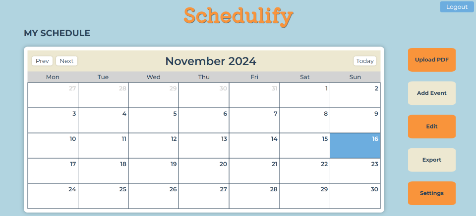
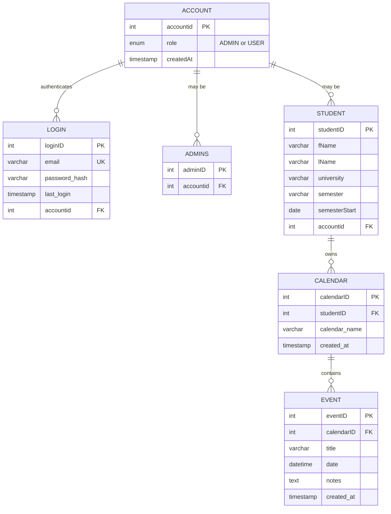
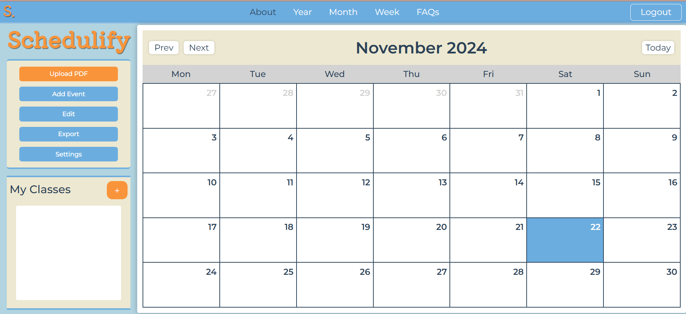
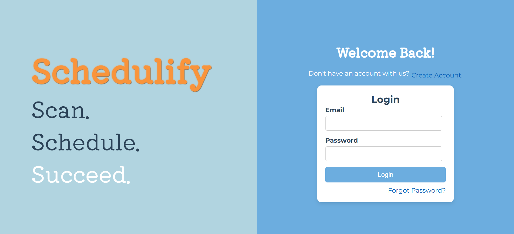
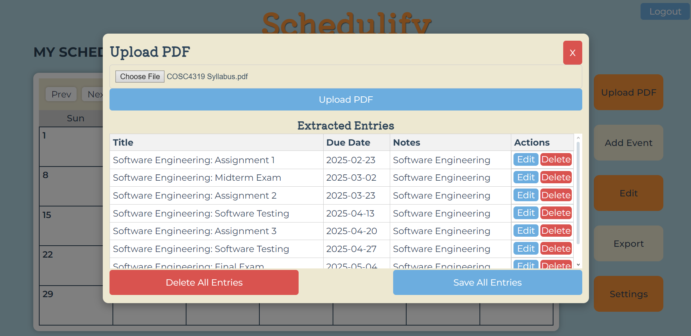
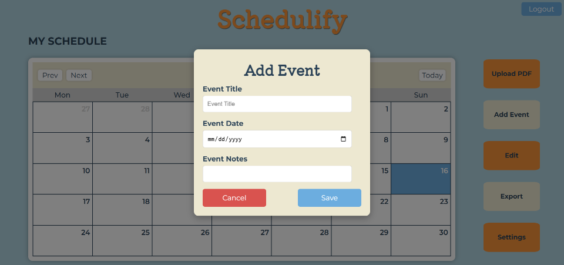
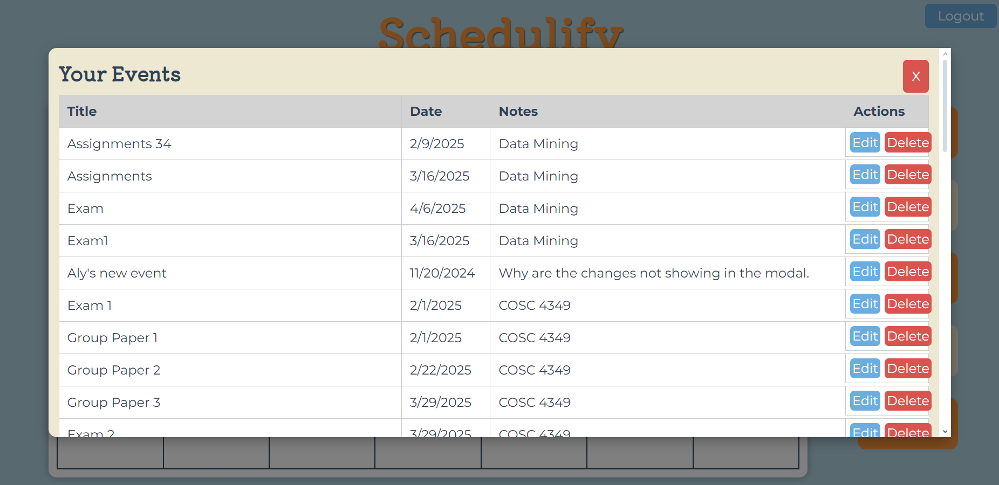
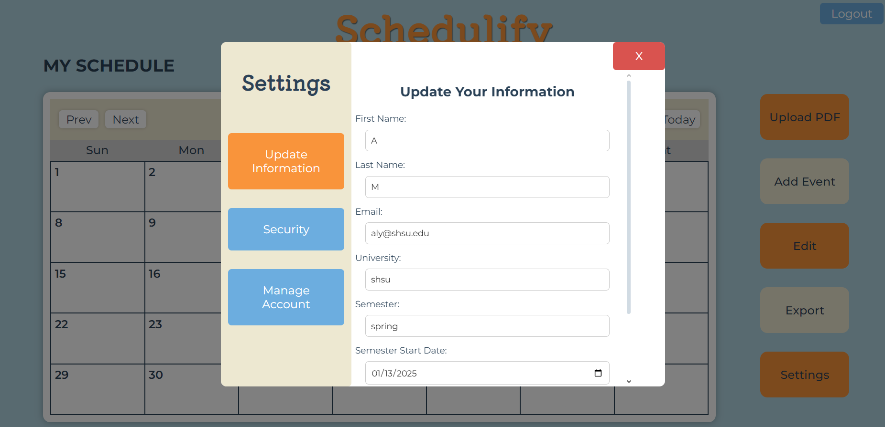

# Schedulify: Case Study

> **Note:** This repo is a case study of a university capstone project (Fall 2024). The original code is a private team repository, so this page covers what we built, how it works, and what I contributed.



## What it does

Schedulify helps university students plan their semester. A student uploads a course syllabus PDF, the app extracts assignments and exams, and the student reviews and edits the results before saving them to an interactive calendar.

**Who it's for:** university students juggling several courses with different syllabus formats.

**The problem:** deadlines are buried in PDFs with no standard format, so students copy dates into calendars by hand.

## Features

- Account creation and login with token-based (JWT) authentication
- Syllabus PDF upload and automatic extraction of assignments and exams
- Scanner review modal: edit any extracted entry, delete entries individually or all at once, then save all to the calendar
- Interactive month calendar
- Manual event creation, plus an events list for editing and deleting saved events
- Calendar export (download as PDF or print)
- Settings to update personal information

**Not implemented (planned):** password reset by email, admin page for removing inactive accounts, mobile-friendly layout.

## Tech stack

| Layer | Technology |
| --- | --- |
| Front end | JavaScript, React.js, Axios |
| Back end | Spring Boot (Java) REST API, Maven, JWT authentication |
| Syllabus scanner | Python (PyMuPDF, regular expressions) and the ChatPDF API |
| Database | MariaDB (schema designed and prototyped in MySQL) |
| Hosting | Vultr Debian Linux VPS, Nginx |
| Workflow | GitHub, Agile (parallel UI, scanner and back-end tracks) |

## How it works

1. **Upload:** the student uploads a syllabus PDF.
2. **Scan:** a Python service pulls text out of the PDF (tables included) and filters it with a dictionary of academic keywords. That refined text and the PDF are sent to the ChatPDF API with tailored prompts, which returns the assignments and their dates.
3. **Review:** the extracted entries appear in a scanner modal, where the student can:
   - edit any entry (title, date, notes)
   - delete entries one at a time, or delete all
   - save all entries to the calendar
4. **Save:** on "Save All Entries", the events are written to the student's calendar in the database.

Schedulify does not store the uploaded PDFs. Note that the document is sent to a third-party API (ChatPDF) for interpretation, and only the events the student chooses to save are kept in our database.

## Architecture

```
Browser (React)
   |  upload PDF (with auth token)
   v
Spring Boot API --> Python scanner (PyMuPDF + regex) --> ChatPDF API
   ^                                                          |
   |                                                          v
   |                              extracted events (returned to the browser, not stored)
   |                                                          |
   |  Save All Entries                                        v
   +--------------------- Scanner modal: edit, delete, save --+
   |
   v
Database (events saved to the student's calendar)
```

### Data model



Accounts have a role (admin or user), with student profile data kept in a separate table. A student owns calendars, and each calendar holds the events saved from syllabi. Deleting a student or calendar cascades to its children, and passwords are stored only as hashes. The `ADMINS` table is part of the schema, but the admin page was not built.

## My role

I was the project planner and front-end developer on a team of four. I:

- Planned the project and kept the team on a development timeline of a little over a month
- Built the complete React front end, including the scanner review modal
- Designed the database schema and wrote the SQL, including the ERD
- Helped a teammate write some of the Spring Boot API endpoints
- Ran code reviews with a focus on front-end quality

I did not write the Python scanner. That was a teammate's work.

## Team

Built by a four-person team for our university capstone course:

- **Alyona M** ([@malys23](https://github.com/malys23)): project planning, database design (SQL and ERD), complete front end, some back-end endpoints
-  ([@jrb3620](https://github.com/jrb3620)): Python syllabus scanner
-  ([@QDizzle03](https://github.com/QDizzle03)): security and JWT authentication
-  ([@ccallisto](https://github.com/ccallisto)): server and deployment, implementing the database, most of the back end

## Challenges and solutions

**1. Reading tables in syllabi (team challenge)**
Early on, the AI matched dates to assignments in syllabus tables only about 20% of the time. The scanner teammate extracted all table text, filtered it with an academic keyword dictionary, and sent the refined text to the AI along with the PDF. This raised accuracy on tables to near-perfect in our testing. I built the review step on the front end as a safety net for the cases the scanner still got wrong.

**2. Reviewing and correcting many events**
Students needed to fix errors before saving. In the scanner modal, each extracted entry can be edited in place, deleted, or saved with the rest in one click, so the student always has the final say.

**3. Connecting the front end to the back end for the first time**
None of us had done this before. The React app sends the user's authentication token with every request to the Spring Boot API, and the team worked out the contract between the two sides endpoint by endpoint.

**4. Scope versus a one-month timeline**
Our original design had a sidebar with classes grouped by color. With a little over a month to build, we rolled it back to the simpler calendar layout and dropped password reset and the admin page, so we could finish the core flow of upload, review, save.

## Original design vision



This is the layout I designed before we cut scope. It included a "My Classes" panel for grouping events by class.

## Known limitations

- If the scanner misses an event, the user has to add it manually. We ran out of time to build this into the review step.
- Password reset, the admin page and a mobile layout were not finished.

## Code samples

Short excerpts of front-end code I wrote:

- [`samples/ScannerModal.jsx`](samples/ScannerModal.jsx): the scanner review modal (upload, edit, delete, save all), shown as it was submitted
- [`samples/schema.sql`](samples/schema.sql): the database schema I wrote

## What I learned

This was the first large web application our team built. If I were starting again, I would:

- Split the scanner modal's handlers into smaller components and hooks instead of keeping everything in one file
- Give each extracted entry a unique ID. I used the entry's date, so two assignments due on the same day could collide
- Let users add a missed event directly from the review modal
- Agree on branching and commit conventions in week one
- Keep secrets and build folders out of version control from the first commit
- Break work into smaller tasks with clearer deadlines, rather than broad start and end dates

## Screenshots

| Login | Calendar | Scanner modal |
| --- | --- | --- |
|  |  |  |

| Add event | Your events | Settings |
| --- | --- | --- |
|  |  |  |

## Contact

Alyona M · [www.linkedin.com/in/amaliassova] · [alyona.maliassova@gmail.com]
